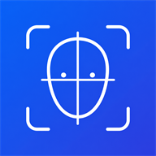
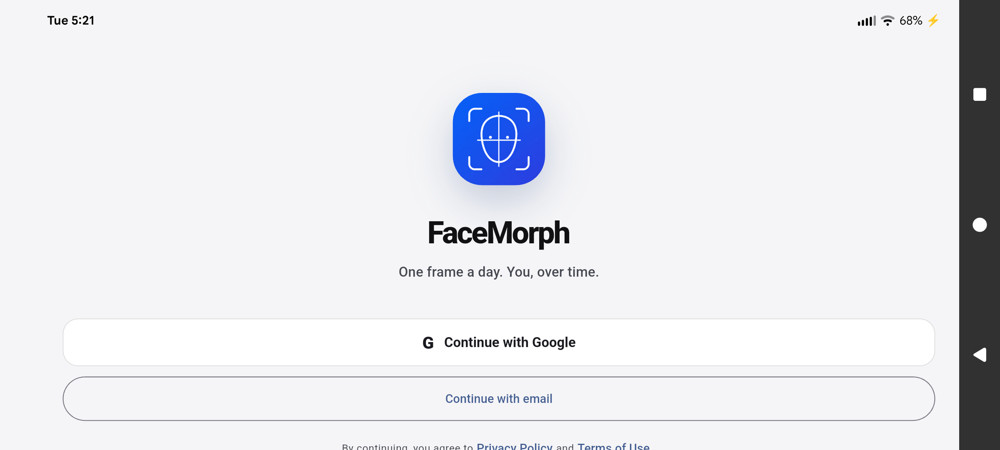

<div align="center">
  

# FaceMorph

**One frame a day. You, over time.**

Build a personal photo timeline with guided capture, a calendar, and shareable timelapse videos.

[](https://github.com/kargalar/facemorph/releases/latest) [](https://github.com/kargalar/facemorph/releases/latest) [](LICENSE)

[Download for Android ↓](https://github.com/kargalar/facemorph/releases/latest) · [Build from source](#build-from-source) · [Report an issue](https://github.com/kargalar/facemorph/issues)

</div>



## See change one day at a time

Use the guided front-camera alignment to capture a consistent daily frame, then watch your timeline take shape. Browse the calendar, preview the animation, and export a local MP4 when you are ready.

## Features

- Guided eye and mouth alignment with live directional feedback.
- Normalize photo rotation, crop, and scale for consistent framing.
- Review daily photos in a calendar and animated preview.
- Create and share MP4 timelapses locally.
- Import gallery photos and move backups with date-preserving ZIP files.
- Choose public or private photo visibility and manage friends and likes.
- Use daily notifications and configurable appearance settings.

## Download and install

Get the latest Android APK from [GitHub Releases](https://github.com/kargalar/facemorph/releases/latest), download it to your device, and install the package.

## Build from source

Requirements: Flutter, the Android SDK, and a configured Firebase project. Google Authentication, Firestore, Cloud Functions, and Bunny.net storage configuration are required for the full online experience.

```sh
flutter pub get
flutter analyze
flutter test
flutter build apk --release
```

Keep Firebase service-account credentials, Bunny.net keys, signing keystores, and local environment files out of the repository. Public Firebase client configuration is not a substitute for server-side secrets management.

## License

FaceMorph is licensed under the GNU General Public License v3.0. See [LICENSE](LICENSE).
